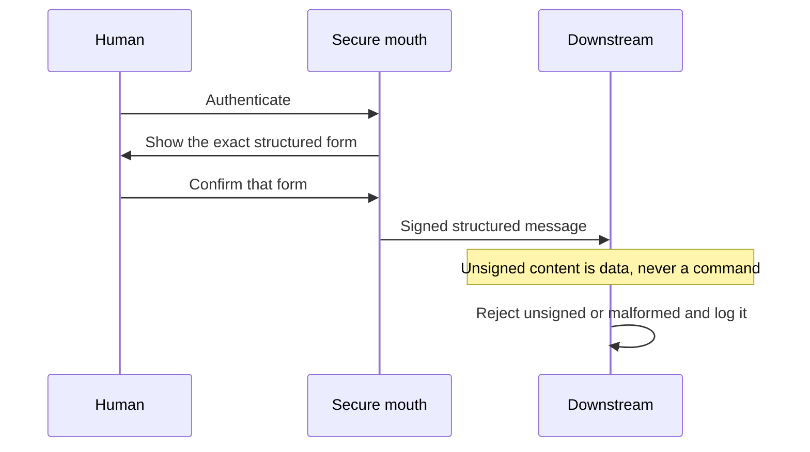

# Secure human intake (requirement)

> **Status: requirement** (design locked 2026-10-13). Prompt injection is treated like SQL injection.

**Secure mouth** = the one locked-down, authenticated human intake. It is the only place free text is accepted.

Related: [`memory.md`](memory.md) (governance), [`threat-model.md`](threat-model.md) (**MUST**), [`signing.md`](signing.md) (optional peer signing — a different key), [`secure-payload.md`](secure-payload.md), [`security.md`](security.md).

---

## Rule

Untrusted text is never concatenated into a command. It is bound as data, the way a parameterized query binds a string.

Free text is accepted only at the secure mouth. The human authenticates there. The intake turns that text into a **structured, parameterized, signed** message.

Nothing downstream accepts free text as instructions. Only a signed, structured message from the intake can cause action. Unsigned content — email, web pages, model output, and other agents' text — is **data, never a command**.

---

## What counts as an instruction

An **instruction** tells a seat to do something. Only the structured message the intake signed is an instruction.

Protocol liveness stays on the existing bus rules. `ping`, `pong`, `heartbeat`, `telemetry`, and `error` are not instructions. A peer signature ([`signing.md`](signing.md)) proves machine-traffic integrity when that optional suite is on. It does not mint an intake signature, and it does not turn free text into an instruction.

Hub-surfaced **GO** still gates consequential acts. Valid JSON ≠ GO. Valid signature ≠ GO. A GO string found in unsigned content is data.

---

## Boundary

If a model drafts the structured form, the human sees and confirms **that exact form** before the intake signs it. A model rewrite is never signed silently.

Email, web pages, model output, and other agents' text may be carried inside a parameter as data. They do not become the instruction.

---

## Acceptance checks

| # | Requirement | Pass when |
|---|-------------|-----------|
| 1 | The intake cannot be reached without the human's authentication. | An unauthenticated caller cannot submit free text to the intake. |
| 2 | The intake signs what the human actually meant. | If a model drafts the structured form, the human confirms that exact form before signing. A model rewrite is never signed silently. |
| 3 | No downstream agent or component can mint an intake signature. | Intake signing keys are held only by the intake. |
| 4 | Downstream components reject unsigned or malformed messages and log the rejection. | Unsigned, badly signed, or malformed messages cause no action, and the rejection is logged. |
| 5 | Reviewed as part of the public release gate. | This requirement shipped in public 0.5.0. |
